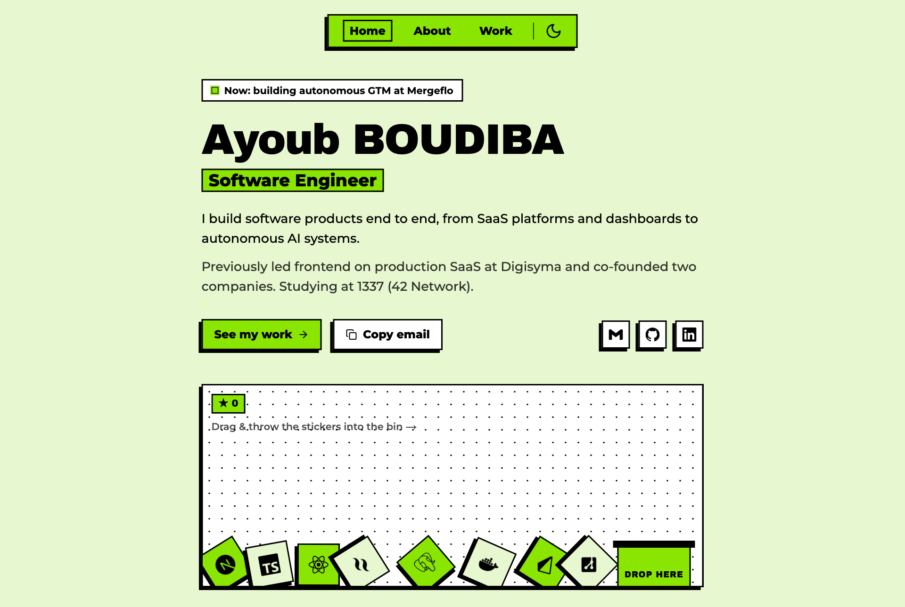

<picture>
  <source media="(prefers-color-scheme: dark)" srcset=".github/preview-dark.png" />
  
</picture>

# Neobrutal Portfolio

A **neobrutalism** portfolio built with Next.js 16, React 19 and Tailwind CSS v4. Thick borders, hard shadows, loud lime — and a hero you can actually play with: **throw the stack stickers into the bin** and chase a combo.

**Live:** [boudiba.me](https://boudiba.me)

[](https://vercel.com/new/clone?repository-url=https%3A%2F%2Fgithub.com%2FYubieTheSAVAGE%2FPortfolio&env=NEXT_PUBLIC_SITE_URL&envDescription=Your%20site%20URL%20without%20trailing%20slash%2C%20e.g.%20https%3A%2F%2Fyourname.dev)

---

## Features

- **Sticker game hero.** Drag and throw your stack stickers into the bin. Tiny custom physics (no library), combos, best score saved per visitor and shown in the footer. Sleeps when nothing moves, pauses offscreen, and turns into a static row with `prefers-reduced-motion`.
- **One config file.** Name, title, bio, socials, email, status badge and SEO all come from `src/site.config.ts`.
- **Generated OG images.** Every page gets a neobrutal share card (`opengraph-image.tsx`) built from your config. Favicon too.
- **Pages:** Home (hero, game, stack marquee, featured work), About (bio, skills, experience timeline), Work (project cards with tags), and a 404 page.
- **Light / dark** theme with `next-themes`, page transitions with `next-view-transitions`, scroll reveals.
- **SEO:** per-page canonical URLs, sitemap, robots, JSON-LD `Person`, theme color.
- **Accessible:** skip link, landmarks, labelled icon links, keyboard-focusable skill tooltips, reduced motion respected.

## Get started

1. Click **Use this template** at the top of this repo (or the Deploy button above).
2. Install and run:

   ```bash
   bun install
   bun dev
   ```

3. Copy `.env.example` to `.env.local` and set `NEXT_PUBLIC_SITE_URL` (also set it in your host's env vars).

## Customize

| What | Where |
| --- | --- |
| Name, title, bio, email, socials, status badge, SEO keywords, sticker set | `src/site.config.ts` |
| Projects (tags, year, `featured` for the home page) | `src/data/projects.ts` + images in `public/` |
| Experience timeline (`start` / `end` as `YYYY-MM`) | `src/data/experience.ts` |
| Skills by category | `src/data/skills.ts` |
| Nav links | `src/data/nav.ts` |
| Colors, shadows, fonts | `src/app/globals.css` (`:root` and `.dark`) and `src/app/layout.tsx` |

**Highlight words in your bio** by wrapping them in `==double equals==` inside `about` in `site.config.ts`.

**Add a skill or sticker icon:** import the icon from [`@icons-pack/react-simple-icons`](https://simpleicons.org/) (or `lucide-react`) and add it to the maps in `src/components/SkillIcon.tsx`, then use its key in `skills.ts` or `heroStack`. Unknown keys fall back to a text badge.

**Tune the game:** gravity, bounce and friction live at the top of `src/components/sticker-game/physics.ts`; combo window and throw speed at the top of `sticker-game.tsx`.

**Preview images** are shown at a 71:26 ratio (e.g. 1420×520).

## Show up on Google

Deploy, open [Google Search Console](https://search.google.com/search-console), add your domain, and submit `https://your-domain/sitemap.xml`. Use **URL inspection → Request indexing** on the homepage to speed up the first crawl.

## Scripts

```bash
bun dev      # dev server
bun run build
bun run lint
```

## Credits

Based on [neobrutalism-templates/portfolio](https://github.com/neobrutalism-templates/portfolio) by Samuel Breznjak. Styling tokens from [neobrutalism.dev](https://neobrutalism.dev). MIT licensed, see [LICENSE](LICENSE).
